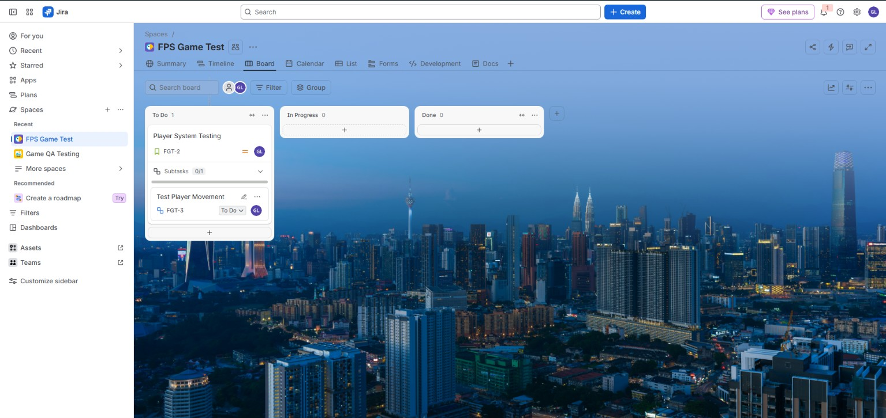
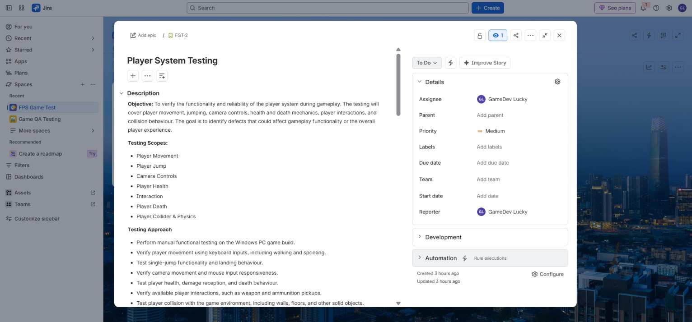
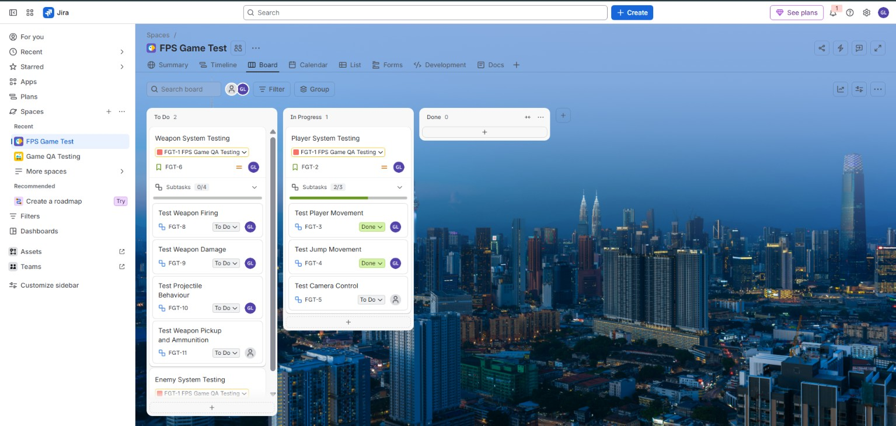

# FPS Game – Manual QA Testing

## Project Overview

This repository documents the manual QA testing of a First-Person Shooter (FPS) game developed using Unity 6.

The project focuses on testing gameplay systems, verifying expected functionality, identifying potential defects, and documenting test execution using Jira.

Testing activities are organized into separate systems to maintain a structured testing workflow.

## Game Information

| Field | Details |
|---|---|
| Game Type | First-Person Shooter |
| Game Engine | Unity 6 |
| Programming Language | C# |
| Platform | Windows PC |
| Testing Type | Manual Functional Testing |
| Test Management Tool | Jira |

## Tools Used

- **Jira:** Test planning, task management, and defect tracking.
- **Unity 6:** Game testing environment.
- **Windows PC:** Testing platform.
- **Git and GitHub:** Version control and project documentation.

## Testing Scope

The project is divided into the following testing areas:

### 1. Player System Testing
Testing player movement, jumping, camera controls, health, interactions, and collision behaviour.

### 2. Weapon System Testing
Testing weapon firing, fire rate, damage, projectile behaviour, pickups, and ammunition handling.

### 3. Enemy System Testing
Testing enemy navigation, attack behaviour, projectile direction, and damage interactions.

### 4. Spawn Gate and Gameplay Objective Testing
Testing enemy spawning, spawn gate destruction, and gameplay win conditions.

### 5. Game Flow and UI Testing
Testing menus, scene transitions, restart functionality, Game Over, and You Win screens.

## Jira Project Structure

Testing activities are managed using an Epic, Stories, and subtasks.

| Jira Issue | Description |
|---|---|
| FGT-1 | FPS Game QA Testing (Epic) |
| FGT-2 | Player System Testing |
| FGT-6 | Weapon System Testing |
| FGT-7 | Enemy System Testing |

Additional testing Stories will be added as the project progresses.

## Current Progress

| Testing Area | Status |
|---|---|
| Player Movement | Completed |
| Player Jump | Completed |
| Camera Controls | Pending |
| Weapon System | Planned |
| Enemy System | Planned |
| Spawn Gate and Objectives | Planned |
| Game Flow and UI | Planned |

## Test Documentation

Detailed test scenarios, expected results, execution results, and evidence are maintained in [Test Document](TestDocument.md).

## Evidence

### Project Setup Board

### Epic: Player System

### Project Progress

## Author

**Akash Devnath**

GitHub: [akash-devnath](https://github.com/akash-devnath)